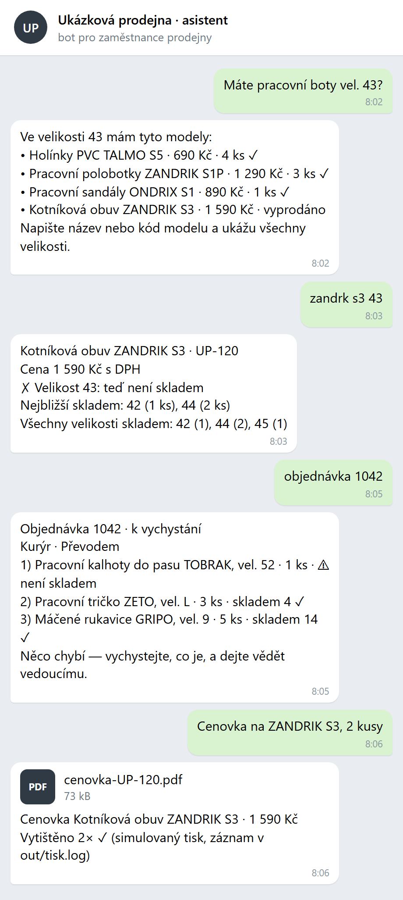
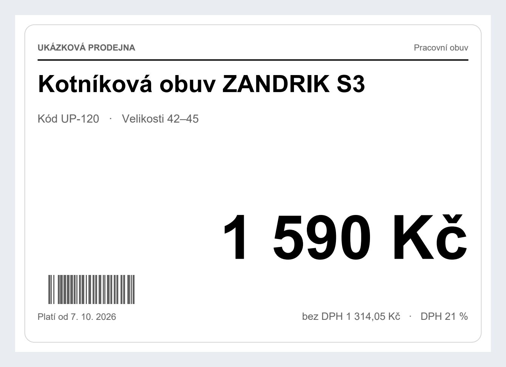
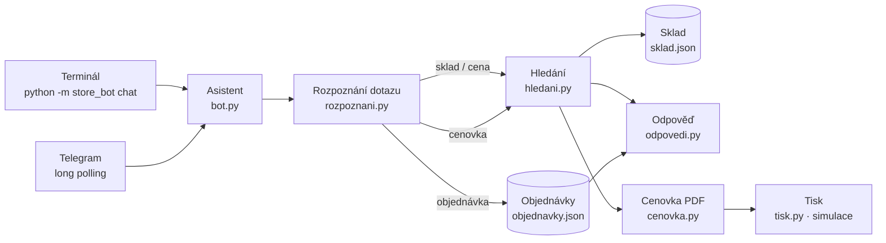

# Asistent prodejny · store-assistant-bot

**Česky** · [English below](#english)

## Prodavač se zeptá telefonu, ne kolegy ve skladu

Zákazník stojí u pultu a chce boty ve 43. Prodavač odběhne do skladu, nebo volá
vedoucímu, nebo hledá v pokladně, kde velikosti vidí jen po jedné. Mezitím čeká
další zákazník. Objednávku z e-shopu vychystává podle vytištěného papíru a nové
cenovky na regál píše ručně fixou.

**Asistent prodejny** je chatovací bot (Telegram) pro zaměstnance. Napíšou mu
obyčejnou větou, co potřebují, a za vteřinu mají odpověď:

| Prodavač napíše | Asistent odpoví |
|---|---|
| „Máte pracovní boty vel. 43?“ | které modely ve 43 jsou skladem a kolik kusů |
| „zandrk s3 43“ (s překlepem) | detail modelu, a když 43 chybí, nejbližší velikosti skladem |
| „Kolik stojí lehká bunda?“ | cenu s DPH i bez DPH |
| „objednávka 1042“ | stav objednávky z e-shopu a u každé položky, jestli je skladem |
| „Cenovka na ZANDRIK S3, 2 kusy“ | vytvoří cenovku v PDF a vytiskne ji 2× |

**Co tím firma získá**

- **Rychlejší obsluhu** — odpověď na sklad i cenu bez odbíhání od zákazníka.
- **Méně chyb při vychystání** — bot upozorní, že objednávka čeká na platbu, byla
  zrušená, nebo že něco není skladem.
- **Jednotné cenovky** — vždy aktuální cena z pokladny, žádné ručně psané cedulky.
- **Žádné školení** — píše se normální češtinou, bez diakritiky i s překlepy.
- **Žádné měsíční poplatky za AI** — rozpoznání dotazů je vlastní a běží offline.

Nasazeno v reálném provozu v maloobchodu s pracovními oděvy (2 firmy, desítky
automatických úloh denně). Tohle repo je ukázka nad vymyšlenými daty — sklad,
objednávky i „Ukázková prodejna“ jsou smyšlené.

<p align="center">
  
  &nbsp;
  
</p>

Chcete něco podobného pro svou prodejnu nebo e-shop? Napište mi:
**Jaroslav Velek** · [jaravelin@gmail.com](mailto:jaravelin@gmail.com)

---

## Technická část

### Architektura

Jádro (`Asistent`) dostane text a vrátí odpovědi. O kanálu nic neví, takže stejná
logika běží v terminálu, v Telegramu i v testech bez sítě.



| Modul | Co dělá |
|---|---|
| `rozpoznani.py` | z věty pozná záměr (sklad, cena, objednávka, cenovka), velikost a počet kopií; bez AI, pravidla nad textem bez diakritiky |
| `hledani.py` | EAN, kód modelu (i bez pomlčky) nebo slova z názvu; snese chybějící diakritiku, skloňování a překlepy (Damerau–Levenshtein) |
| `odpovedi.py` | krátké texty čitelné na telefonu; u vyprodané velikosti nabídne nejbližší skladem |
| `cenovka.py` | cenovka A6 na šířku (ReportLab), cena s DPH i bez, čárový kód kódu modelu |
| `tisk.py` | simulovaná tiskárna — úlohu zapíše do `out/tisk.log`; skutečná tiskárna má stejné rozhraní |
| `telegram.py` | long polling jen se standardní knihovnou, volitelný seznam povolených chatů, token se nikdy nevypisuje |
| `sklad.py` | načtení ukázkových dat; v reálném nasazení je na tomto místě kopie skladu z pokladního systému (POS) a objednávky z e-shopu |

### Spuštění

Potřebujete Python 3.10+.

```bash
pip install -e .            # jediná závislost: reportlab
python -m store_bot demo    # přehraje ukázkové dotazy a vytvoří out/cenovka-UP-120.pdf
python -m store_bot chat    # interaktivní chat v terminálu („konec“ ukončí)
```

**Telegram (volitelné, s vlastním botem):** u @BotFather si založte bota,
zkopírujte `.env.example` na `.env` a doplňte `TELEGRAM_TOKEN`. Volitelně
`TELEGRAM_ALLOWED_CHATS` omezí přístup na vybrané chaty (cizí chat dostane jen
své chat ID, žádná data).

```bash
python -m store_bot telegram
```

### Testy

```bash
pip install -e .[dev]
pytest
```

Testy pokrývají rozpoznání dotazů, hledání (diakritika, skloňování, překlepy,
EAN, kód), texty odpovědí, obsah PDF cenovky (i bez systémového písma),
simulovaný tisk a Telegram kanál s falešným API (bez sítě).

Obrázky v `docs/` se přegenerují příkazem `python tools/screenshoty.py`
(`pip install -e .[screenshots]` a `python -m playwright install chromium`).

### Data

`store_bot/data/sklad.json` — 11 vymyšlených modelů, 37 skladových karet
(velikostí); EAN jsou v interním rozsahu 200… s platnou kontrolní číslicí.
`store_bot/data/objednavky.json` — 5 ukázkových objednávek v různých stavech.

---

<a id="english"></a>

# Store assistant · store-assistant-bot

## Shop staff ask their phone, not a colleague in the stockroom

A customer at the counter wants work boots in size 43. The salesperson walks to
the stockroom, calls a colleague, or digs through the till system that shows one
size at a time — while the next customer waits. Web orders are picked from a
printed sheet and new shelf price tags are written by hand.

**Store assistant** is a chat bot (Telegram) for shop staff. They type a plain
Czech sentence and get an answer in a second:

| Staff types (Czech) | Assistant replies with |
|---|---|
| “Máte pracovní boty vel. 43?” (*work boots size 43?*) | which models are in stock in 43 and how many |
| “zandrk s3 43” (with a typo) | the model detail and, if 43 is sold out, the nearest sizes in stock |
| “Kolik stojí lehká bunda?” (*price of the light jacket?*) | price incl. and excl. VAT |
| “objednávka 1042” (*order 1042*) | web order status and stock for every line |
| “Cenovka na ZANDRIK S3, 2 kusy” (*price tag, 2 copies*) | generates a PDF price tag and prints it twice |

**What the business gets**

- **Faster service** — stock and price answers without leaving the customer.
- **Fewer picking mistakes** — the bot warns when an order is unpaid, cancelled
  or an item is out of stock.
- **Consistent price tags** — always the current till price, no handwritten signs.
- **No training** — plain language, works without diacritics and with typos.
- **No monthly AI fees** — query recognition is rule-based and runs offline.

Deployed in production in workwear retail (2 companies, dozens of automated
tasks per day). This repository is a showcase on made-up data — the stock,
orders and the “Ukázková prodejna” (*Sample Store*) are fictional.

Want something similar for your shop or e-shop? Get in touch:
**Jaroslav Velek** · [jaravelin@gmail.com](mailto:jaravelin@gmail.com)

## Technical overview

The core (`Asistent`) takes text and returns replies. It knows nothing about the
channel, so the same logic runs in the terminal, in Telegram and in offline
tests. See the Mermaid diagram and module table above; identifiers are in Czech,
as in the production code.

- `rozpoznani.py` — intent (stock, price, order, price tag), size and copy count from a sentence; rules, no AI
- `hledani.py` — EAN, model code or name words; tolerant to missing diacritics, Czech inflection and typos (Damerau–Levenshtein)
- `odpovedi.py` — short phone-friendly replies; suggests nearest sizes in stock
- `cenovka.py` — A6 landscape price tag (ReportLab) with Code 128 barcode
- `tisk.py` — simulated printer logging to `out/tisk.log`; a real printer has the same interface
- `telegram.py` — long polling with the standard library only, optional chat allow-list, token never logged
- `sklad.py` — loads sample data; in production this is a copy of the POS stock and the e-shop orders

### Run

```bash
pip install -e .
python -m store_bot demo     # replays sample queries, writes out/cenovka-UP-120.pdf
python -m store_bot chat     # interactive terminal chat ("konec" quits)
python -m store_bot telegram # optional: needs your own TELEGRAM_TOKEN in .env
```

### Tests

```bash
pip install -e .[dev]
pytest
```

## License

All rights reserved. The source is published for viewing only — see [LICENSE](LICENSE).
